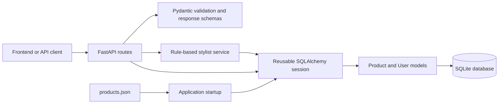

# Architecture

Routes handle HTTP and status codes. Pydantic schemas validate input and shape output. The stylist service scores catalog matches. Database sessions and SQLAlchemy models own persistence. Startup creates tables and seeds an empty product catalog.
